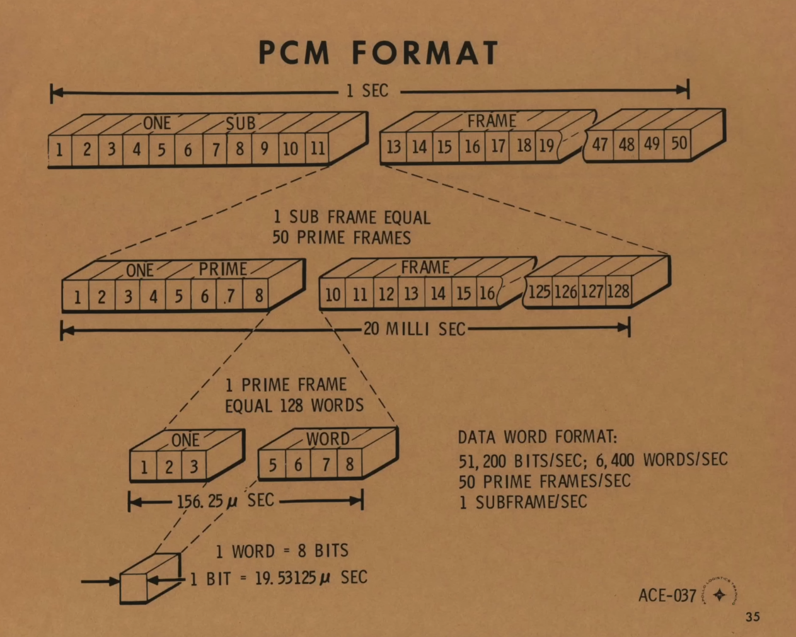
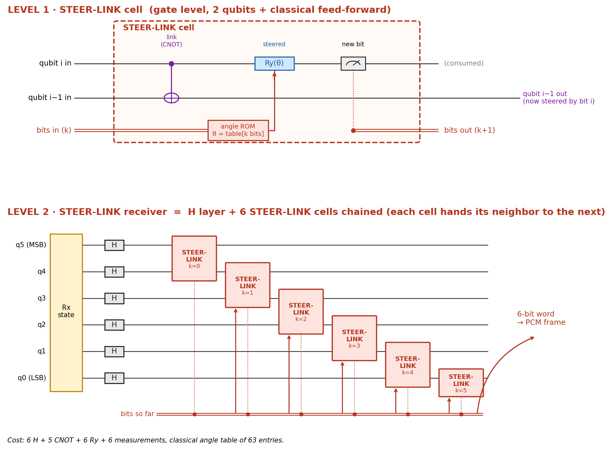
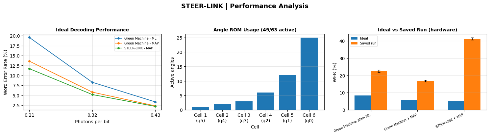

# STEER-LINK
### Adaptive Quantum Receiver for Rocket PCM Telemetry

STEER-LINK is an experimental six-qubit quantum receiver designed to decode telemetry data represented as six-bit Pulse Code Modulation (PCM) residual words. It combines CNOT gates, adaptive rotations, mid-circuit measurements, and classical feed-forward.

The objective is to investigate whether measurement-guided quantum operations can improve telemetry decoding compared with a conventional Hadamard-based receiver.

## 1. What Is PCM in Rocket Telemetry?

Pulse Code Modulation (PCM) is a method of representing sampled sensor measurements as digital binary data. In rockets, telemetry systems use PCM to organize information from sensors and onboard subsystems into a structured data stream that can be transmitted to a ground station.

This data can contain measurements such as altitude, acceleration, temperature, pressure, and other flight parameters. The ground station decodes the received bitstream to reconstruct the transmitted measurements.

### PCM Frame Format

The following reference diagram illustrates a PCM data structure, showing how bits are grouped into words, words into frames, and frames into subframes.

<p align="center">
  
</p>

According to the illustrated format:

- One word contains 8 bits.
- One prime frame contains 128 words.
- One subframe contains 50 prime frames.
- The illustrated data rate is 51,200 bits per second, corresponding to 6,400 words per second.
- The illustrated format has a subframe duration of 1 second.

This hierarchy organizes the sensor data into predictable units, allowing the receiving system to interpret the incoming telemetry stream.

**Project scope:** STEER-LINK uses a simplified six-bit residual-word model for its experiments. It does not implement a complete decoder for the eight-bit PCM format shown above.

## 2. The Problem

Telemetry decoding becomes more challenging when the received signal has limited energy and the measurement process is unreliable.

A conventional receiver can use a fixed sequence of quantum operations followed by measurement. However, this does not adapt its quantum operations according to intermediate measurement results.

STEER-LINK investigates an alternative: use previously measured bits to select the rotation angles applied during subsequent decoding stages.

The main challenge is determining whether this adaptive strategy provides a meaningful decoding improvement after accounting for circuit complexity and quantum hardware noise.

## 3. STEER-LINK Circuit

The circuit has two levels: an individual STEER-LINK cell and a complete six-qubit receiver.

<p align="center">
  
</p>

### Level 1 — STEER-LINK Cell

Each cell performs three main operations.

**1. CNOT Link**

A controlled-NOT gate couples neighbouring qubits, introducing a conditional interaction before the current qubit is measured.

**2. Adaptive Rotation**

The cell applies an `Ry(θ)` rotation. Its angle is selected from a classical lookup table, called the angle ROM, using the measurement results obtained from preceding cells.

**3. Mid-Circuit Measurement**

The current qubit is measured, and its resulting classical bit becomes available to subsequent stages.

This measurement-conditioned control allows the receiver to change its later operations according to the bits already obtained.

### Level 2 — Complete Receiver

The complete receiver processes six qubits through the following stages:

1. **Received-state preparation:** Constructs the simulated quantum state corresponding to a residual word.
2. **Hadamard layer:** Applies six Hadamard gates to transform the received state.
3. **Adaptive processing:** Chains six STEER-LINK cells, processing qubits from `q5` (MSB) to `q0` (LSB).
4. **Classical reconstruction:** Collects the six measurement bits to produce a decoded word.

### Circuit Resources

| Component | Count |
|---|---:|
| Qubits | 6 |
| Hadamard gates | 6 |
| Nearest-neighbour CNOT gates | 5 |
| Adaptive rotation stages | 6 |
| Measurements | 6 |
| Classical angle ROM entries | 63 |

These counts describe the nominal receiver structure. The complete simulated experiment also contains gates for received-state preparation, and transpilation can change the final circuit resource requirements.

## 4. What Makes STEER-LINK Different?

The key idea is **measurement-guided adaptive decoding**.

Unlike a receiver that applies the same fixed processing sequence to every measurement history, STEER-LINK selects rotation angles according to previously measured bits.

Its main features are:

- **Classical feed-forward:** Intermediate measurement results influence subsequent quantum operations.
- **Adaptive angle ROM:** A 63-entry lookup table stores the rotation angles associated with possible measurement prefixes.
- **Local quantum interactions:** Neighbouring qubits are coupled using CNOT gates.
- **Angle pruning:** Small rotation angles can be set to zero, potentially reducing conditional operations.
- **Classical MAP decoding:** The receiver can use learned residual-word probabilities when interpreting the measured output.

The innovation being investigated is the integration of these mechanisms into a single adaptive receiver. Whether they produce a practical advantage must be established through experimental evaluation.

## 5. Results and Performance Analysis

The following figure summarizes the ideal decoding performance, active angle-ROM entries, and comparison between ideal predictions and a saved experiment.

<p align="center">
  
</p>

### Ideal Decoding Performance

The first graph compares three receiver configurations:

- Green Machine with plain maximum-likelihood (ML) decoding.
- Green Machine with maximum a posteriori (MAP) decoding.
- STEER-LINK with MAP decoding.

At approximately **0.32 photons per bit**, the displayed ideal-model results show:

| Receiver | Ideal WER |
|---|---:|
| Green Machine — plain ML | 8.29% |
| Green Machine + MAP | 5.81% |
| STEER-LINK + MAP | 5.21% |

STEER-LINK achieves a lower ideal-model WER than Green Machine + MAP in this configuration. The reduction is approximately 0.60 percentage points, or 10.3% relative to the Green Machine + MAP WER.

The ideal graph also shows decreasing WER as the modeled photon level increases.

These results describe the ideal model and do not establish that STEER-LINK performs better on a physical quantum processor.

### Angle ROM Usage

The second graph shows the number of active rotation angles in each cell after pruning.

The displayed configuration uses **49 of the 63 available ROM entries**. This indicates that some conditional rotations have been eliminated because their angles fall below the configured pruning threshold.

The active-angle count measures ROM usage; it does not, by itself, establish the total gate savings or circuit execution advantage.

### Ideal vs Saved Experiment

The third graph compares ideal-model predictions with the results recorded in a saved experiment. In the displayed figure, the saved-run WER is approximately:

| Receiver | Saved-run WER shown |
|---|---:|
| Green Machine — plain ML | 22.3% |
| Green Machine + MAP | 16.7% |
| STEER-LINK + MAP | 41.18% |

The displayed STEER-LINK result is substantially worse than the Green Machine + MAP result. Therefore, the figure does not demonstrate a practical decoding advantage for STEER-LINK in that run.

The gap between ideal predictions and the saved-run results highlights the importance of circuit noise, measurement errors, state preparation, and execution overhead.

The saved-run values should only be described as real quantum hardware measurements when they can be verified against the corresponding completed IBM Quantum job. Otherwise, they must be identified according to their actual source, such as simulation or previously saved output.

### Overall Interpretation

The ideal-model results suggest that adaptive processing may improve decoding for the simulated telemetry distribution. However, the saved-run comparison shows that this potential improvement does not automatically translate into better observed performance.

Further work is needed to investigate noise-aware angle optimization, circuit resource reduction, repeated measurements, and statistically reliable performance comparisons.

## 6. Technology Stack

| Technology | Purpose |
|---|---|
| Python | Main implementation |
| Qiskit | Quantum circuit construction |
| Qiskit Aer | Ideal and noisy simulation |
| Qiskit IBM Runtime | IBM Quantum execution |
| NumPy | Numerical modeling |
| SciPy | Angle optimization |
| Matplotlib | Circuit and performance visualization |
| Pandas | Results tables |

## 7. Installation

For Google Colab, install the required libraries using:

```python
%pip install -q qiskit qiskit-aer qiskit-ibm-runtime scipy numpy matplotlib pandas pylatexenc
```

The implementation supports ideal simulation, noisy simulation, noise sweeps, and IBM Quantum hardware execution.

Hardware execution requires a valid IBM Quantum API key, an accessible service instance, and a compatible backend. Credentials should never be committed to a public repository.

## 8. Acknowledgments and Third-Party Resources

This project uses the following open-source libraries and their official documentation:

- [Qiskit](https://docs.quantum.ibm.com/) — quantum circuit construction.
- [Qiskit Aer](https://qiskit.github.io/qiskit-aer/) — circuit simulation.
- [Qiskit IBM Runtime](https://quantum.cloud.ibm.com/docs/en/guides) — quantum hardware execution.
- [NumPy](https://numpy.org/doc/) and [SciPy](https://docs.scipy.org/doc/scipy/) — numerical modeling and optimization.
- [Matplotlib](https://matplotlib.org/stable/) and [Pandas](https://pandas.pydata.org/docs/) — visualization and result analysis.

Any third-party code snippets or tutorial-derived implementations incorporated into the repository should be attributed to their original sources. Third-party libraries remain subject to their respective licenses.

AI assistance was used during development to help refine and debug portions of the implementation and documentation.

**Results are clearly labeled and not falsely claimed as real quantum hardware results.**
